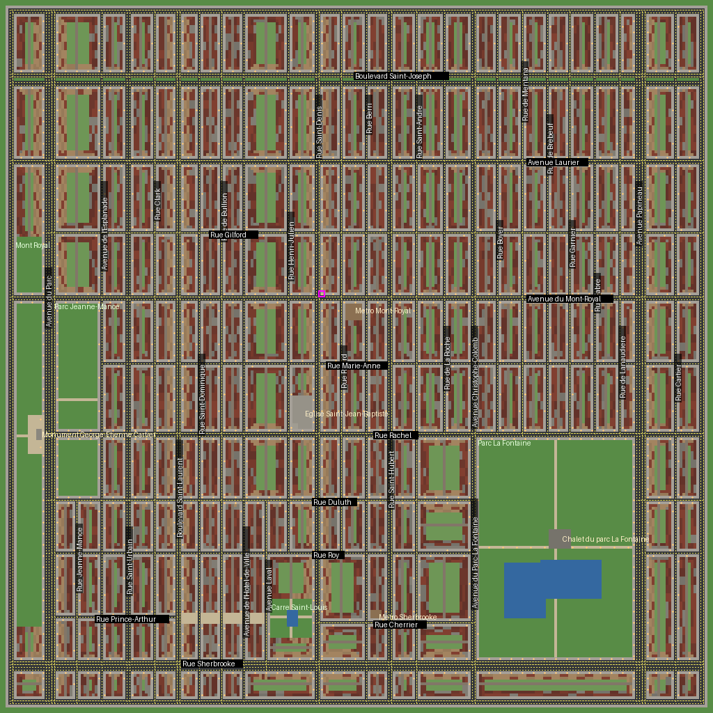

# Plateau-Mont-Royal map

Tools that build a GTA2 map of the Plateau-Mont-Royal neighbourhood in Montreal,
to play with this renderer.



## What is in the map

- The street grid from avenue du Parc to rue Cartier, and from rue Sherbrooke to
  boulevard Saint-Joseph. Montreal's own grid is used, as on the city's street
  signs: "north" runs along Saint-Laurent, away from the river. That puts
  Mount Royal on the west edge of the map.
- Traffic arrows that follow the real one-way streets on the main roads:
  Saint-Laurent goes north, Saint-Urbain and Saint-Dominique go south, and
  Saint-Denis, Mont-Royal, Rachel, Laurier, Sherbrooke, Parc and Papineau are
  two-way. Saint-Joseph has its grass median.
- Rows of two- and three-storey plexes on every block, with a lane (ruelle)
  down the middle of each long block and yards behind the houses. The
  commercial streets have taller buildings.
- Parc La Fontaine with its ponds and chalet, Parc Jeanne-Mance, the foot of
  Mount Royal with the George-Etienne Cartier monument, the Carre Saint-Louis
  with its fountain, and the pedestrian part of rue Prince-Arthur.
- The Eglise Saint-Jean-Baptiste on Rachel, and the Mont-Royal and Sherbrooke
  metro entrances. Landmarks stand behind the sidewalk, never on it.
- About 1,800 street lamps in the warm white of Montreal's LED lamps (3000 K).
  The renderer turns them into RTX Remix lights like the game's own.
- A two-lane ring road around the edge, so that no street ends in a wall.

The street positions are estimates written by hand in `plateau_layout.py`. They
keep the order of the streets and the size of the parks close to the real
neighbourhood, but they are not survey data. To move a street, change its
number there and build again. The map is about 9 m to a block east-west and
7 m north-south, so the Plateau fits GTA2's 256 x 256 blocks.

## Build it

You need Python 3.8 or newer, with numpy and Pillow.

1. Choose the tiles from your own copy of GTA2. The map uses the Residential
   district's style (`ste.sty`):

   ```bat
   python pick_tiles.py "C:\Games\GTA2" --out palette.json --sheet tiles.png
   ```

   This prints the tile it chose for each surface and why. Open `tiles.png` to
   see every tile with its number. To change a choice, edit its number in
   `palette.json`.

2. Build the map:

   ```bat
   python make_plateau_map.py out --palette palette.json
   ```

   `out` then holds `plateau.gmp`, `plateau.mmp`, `plateau.mis`, a preview
   picture and a report.

   The map uses fewer than 200 kinds of block, but the file holds 4,000: the
   rest are unused padding. Renderer builds made before this map came out
   compare 4,000 block records when they work out which map is loaded, and a
   shorter list would make them read past its end.

3. Copy `plateau.gmp` and `plateau.mmp` into the GTA2 `data` folder.

The renderer needs no change: it reads whatever map the game has loaded, and it
finds the style from `plateau.mmp`.

## Play it

GTA2 also needs a compiled mission script (`plateau.scr`) to start a map. Two
ways to get into the Plateau:

- **Quick look, no script.** Back up `data\ste.gmp`, copy `plateau.gmp` over it,
  and start the Residential district. You play the Plateau with that district's
  script, so its missions do not fit the streets, and you may start on a
  rooftop. Copy the backup back afterwards.
- **Its own level.** Compile `plateau.mis` with GTA2's mission compiler into
  `data\plateau.scr`. The script places the player on the corner of
  Saint-Denis and Mont-Royal. It has not been tested with the compiler yet, so
  check it against the compiler's own sample scripts first.

## Montreal sun

`montreal_timeofday.ini` sets the renderer's sun to Montreal's latitude and the
season. Open it for the steps. In short: change the five values in the
`[timeofday]` section of `gta2dx9.ini` to the ones in the file. Change them,
do not add a second copy. If you have saved settings from the F4 menu before,
`gta2dx9_settings.ini` wins over `gta2dx9.ini`, so set the same values in the
F4 menu and press Save.

The renderer's clock is solar time, with no daylight-saving time. A Montreal
summer sunset at 20:45 on a clock is about 19:45 on the renderer's clock.

## Options

| Option | What it does |
| --- | --- |
| `--palette palette.json` | Tiles from `pick_tiles.py`. Without it the map uses placeholder tiles and the textures are wrong. |
| `--style ste.sty` | The style named in `plateau.mmp`. Default: the palette's. |
| `--nav-zones` | Adds named areas: one main zone (plateau) over the whole map, and local areas inside it (mntroyal, stlaur, stdenis, parcfont). GTA2 shows an area's name from its text file, which does not have these names, so they may show blank. Off by default. |
| `--no-lights` | Leaves out the street lamps. |

## Tests

```bat
python test_plateau.py
```

The tests need no GTA2 files. They build the map with a made-up style and
check that:

- every cell has ground and no building goes above level 7
- every traffic arrow leads to another road cell
- a car can drive from any road cell to any other one
- every storey of every building has a solid wall on each open side
- no building stands right at the kerb
- the block list is padded to 4,000
- the navigation zones are one main zone with local areas inside it
- `pick_tiles.py` finds all twelve tiles in a map where the answer is known

With a C++ compiler on the PATH they also load the map with the renderer's own
parser and mesh builder (`src/gta2_map.cpp`, `src/world_mesh.cpp`, through
`tools/dump_block.cpp audit`) and check that no triangle is wider than one
block. The one exception is the seal: a single quad the mesh builder lays under
every map.

## Files

| File | What it is |
| --- | --- |
| `plateau_layout.py` | Streets, parks, water, plazas, landmarks: the part to edit |
| `make_plateau_map.py` | Turns the layout into a map |
| `pick_tiles.py` | Chooses tiles from your GTA2 style |
| `gmp.py` | Reads and writes `.gmp` files |
| `montreal_timeofday.ini` | The renderer's sun for Montreal |
| `test_plateau.py` | The tests |
